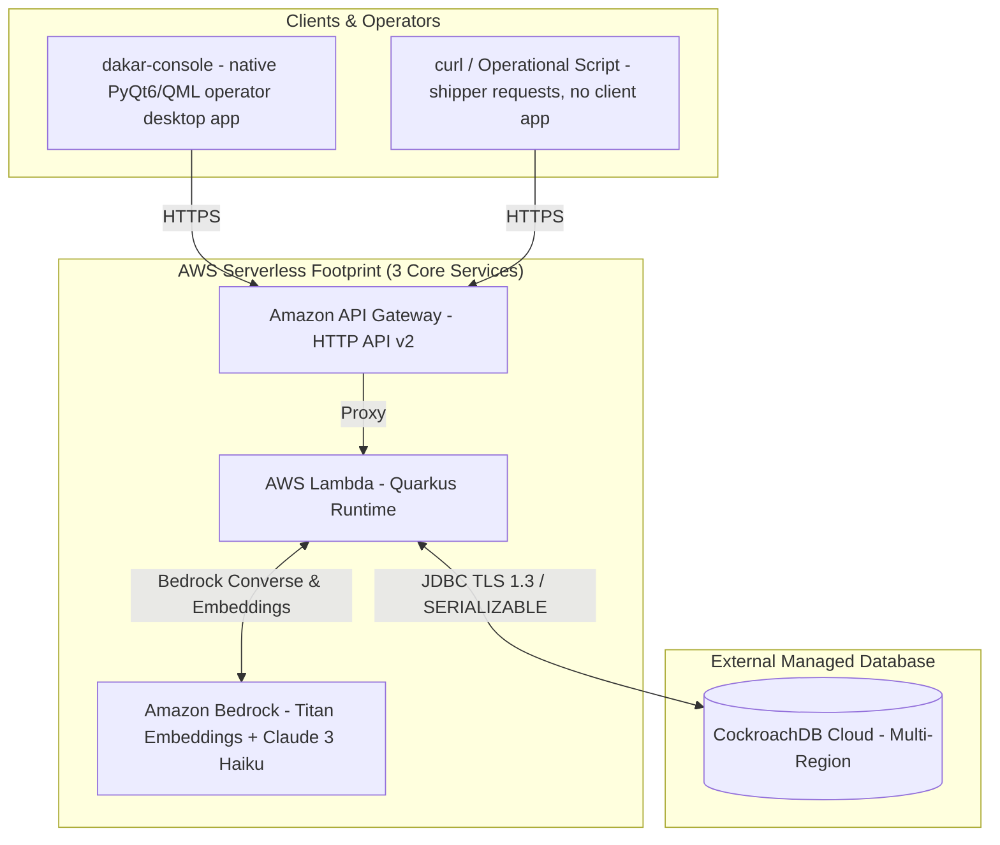

# Dakar — Minimal AWS Infrastructure Specification (`aws.md`)

**Title:** Ultra-Minimal Production & Demo Infrastructure Architecture on AWS  
**Status:** Normative v1.0 — Demo Infrastructure Specification  
**Audience:** Dakar engineering, Stakeholders, Challenge Reviewers  
**Companions:** [system_architecture.md](system_architecture.md) (system authority), [demo_script.md](demo_script.md) (demo script)

---

## 1. Overview & Infrastructure Philosophy

For Dakar's live demo and production deployment, we adhere to a **strict minimalism principle**: *if an AWS component is not actively used in the current operational flow, it is excluded.*

We do not provision future speculative infrastructure (no S3 buckets, no Secrets Manager, no complex VPC NAT gateways, no container orchestrators). All operational state, event journals, decision logs, and vector embeddings reside in **CockroachDB Cloud**.

### The 3-Component AWS Stack

Our active AWS footprint consists exclusively of three serverless services:

1. **Amazon API Gateway (HTTP API v2)** — HTTP Ingress & Lambda Proxy
2. **AWS Lambda (Quarkus Serverless Runtime)** — Application Logic & Agent Execution Shell
3. **Amazon Bedrock** — AI Reasoning & Vector Embeddings

---

## 2. Minimal Architecture Diagram



---

## 3. Infrastructure Component Justifications

| AWS Component | Service Type | Role in Active System | Strong Justification for Demo |
|---|---|---|---|
| **Amazon API Gateway** | HTTP API (v2) | Single entry point & HTTP router | **Zero server management, instant HTTP ingress**. Automatically routes all `/v1/*` traffic directly to Lambda with sub-10ms entry latency. Eliminates the need for ALBs or NGINX proxies. |
| **AWS Lambda** | Serverless Compute | Executes Quarkus App & Agent logic | **100% Stateless execution**. Houses the complete Java 21 Quarkus application runtime (`1024MB` for the HTTP/negotiator/dispatcher functions, `512MB` for the coordinator sweep). Scales to zero when idle, matching Dakar's core rule that **all persistent state lives in CockroachDB Cloud**. |
| **Amazon Bedrock** | Managed AI Engine | Agent deliberation & vector embeddings | **Native AI capabilities without managing GPUs**. Titan Embeddings v2 generates vector embeddings for CockroachDB pgvector RAG; Claude 3 Haiku drives autonomous dispatch/negotiation deliberation via Converse tool use. |

---

## 4. Deep-Dive System Flows & Access Patterns

### Flow 1: Client Ingress & Operational API Execution

```
[Shipper (curl) / dakar-console operator app] ──(HTTPS)──► [API Gateway (HTTP API v2)] ──► [AWS Lambda (Quarkus)]
```

- **Access Pattern**:
  1. A shipper calls the API directly with `curl` (no client app), or an operator's `dakar-console` desktop app calls it on their behalf (e.g. `POST /v1/deliveries`, `POST /v1/deliveries/{id}/assign`).
  2. **API Gateway** proxies the payload directly to the **AWS Lambda** function.
  3. **Lambda** checks the `X-Staff-Access-Key` header on staff-only endpoints, geocodes addresses (Nominatim) on delivery creation, and issues a `SERIALIZABLE` SQL transaction to **CockroachDB Cloud**.
  4. Response is returned back through API Gateway to the client in real-time.

### Flow 2: Agent Perception & Bedrock RAG Deliberation

```
[AWS Lambda] ──(Vector Query)──► [CockroachDB Cloud (pgvector)]
     │
     ├──(Historical RAG Context)──► [Amazon Bedrock (Claude 3 Haiku / Titan)]
     │                                     │
     └◄──────(Calculated Offer)────────────┘
```

- **Access Pattern**:
  1. When a delivery quote is requested, **Lambda** invokes **Amazon Bedrock (Titan Embeddings v2)** to generate a 1024-dimensional vector embedding of the lane request.
  2. **Lambda** queries **CockroachDB Cloud** using pgvector cosine distance (`negotiation_episode`) to fetch the 5 most relevant past negotiation outcomes.
  3. **Lambda** sends the historical RAG context and policy constraints to **Amazon Bedrock (Claude 3 Haiku)** via the Converse API.
  4. Bedrock returns the calculated offer and rationale text, which Lambda writes to `decision_trace` in CockroachDB Cloud and returns to the client.

### Flow 3: Direct TLS Database Connection to CockroachDB Cloud

```
[AWS Lambda Runtime] ──(TLS 1.3 JDBC / SNI)──► [CockroachDB Cloud (Serverless/Dedicated)]
```

- **Access Pattern**:
  - Lambda connects directly to CockroachDB Cloud via standard JDBC connection parameters passed through environment configuration (`QUARKUS_DATASOURCE_JDBC_URL`).
  - Connection pooling (Agroal) manages connections efficiently.
  - Transactions use `SERIALIZABLE` isolation with automated client-side retries on code `40001`.

---

## 5. Summary: Why This 3-Component Setup is Perfect for the Demo

1. **Zero Bloat**: No unused S3 buckets, no Secrets Manager overhead, no VPC NAT gateways, no complex IAM role sprawl.
2. **100% Active**: Every single component (API Gateway, Lambda, Bedrock) is actively invoked in the live system flows.
3. **Smooth Stakeholder Presentation**: Demonstrates clean serverless compute on AWS paired with multi-region persistent memory on CockroachDB Cloud.
